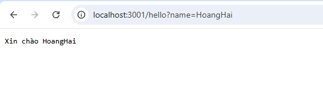
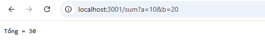
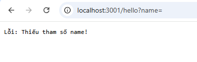
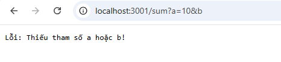
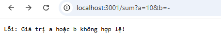
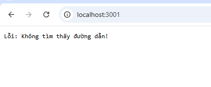

# BÀI 07 - TẠO WEB SERVER BẰNG NODE.JS

## 1. Mục tiêu

- Sử dụng module http để tạo Web Server.

- Sử dụng đối tượng URL để xử lý đường dẫn và tham số.

- Tạo Web Server tại cổng 3001.

- Xử lý yêu cầu chào hỏi và tính tổng.

- Kiểm tra tham số và thông báo lỗi khi dữ liệu không hợp lệ.

## 2. Cấu trúc thư mục

Bt07/

├── bai07.js

├── README.md

└── images/

## 3. Nội dung chương trình

### Chức năng 1: Chào hỏi
Truy cập:

http://localhost:3001/hello?name=HoangHai

Kết quả:
Xin chào HoangHai



### Chức năng 2: Tính tổng
Truy cập:
http://localhost:3001/sum?a=10&b=20

Kết quả:
Tổng = 30



### Chức năng 3: Kiểm tra lỗi

- Thiếu tham số name.



- Thiếu tham số a hoặc b.



- Giá trị a hoặc b không hợp lệ.



- Đường dẫn không tồn tại.



## 4. Các lệnh thực hiện

Kiểm tra phiên bản Node.js:

```bash
node -v
npm -v
```

Chạy chương trình:

```bash
node bai07.js
```


